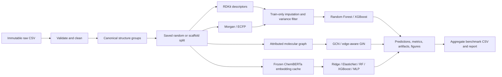

# PolyTg-Bench

## Benchmarking Molecular Representations for Polymer Glass-Transition Temperature Prediction

PolyTg-Bench is a research-oriented framework for controlled comparison of molecular representations
for supervised polymer glass-transition temperature (Tg) prediction. Its central question is: **when do
richer molecular representations improve Tg prediction over simpler 2D representations?**

The repository implements the five primary phases: an auditable CSV-to-results pipeline comparing fixed
RDKit 2D descriptors, Morgan/ECFP fingerprints, molecular graphs, and frozen chemical-language-model
embeddings. Classical models include regularized linear models, Random Forest, XGBoost, and an MLP;
graph models include configurable GCN and edge-aware GIN/GINE networks. Repeated-seed summaries, paired
bootstrap comparisons, publication-ready figures, and an evidence-derived report complete the protocol.



## Research questions

The full benchmark is designed to test whether graphs and pretrained embeddings provide consistent
benefits beyond descriptors and ECFP fingerprints; whether those benefits survive scaffold splitting;
and whether any gain justifies additional computation. Phases 1 and 2 establish the classical 2D baselines
and the shared data protocol required to answer those questions without moving the goalposts.

## Dataset

Supply a CSV with at least one SMILES column and one numeric Tg column. Column names, paths, target
units, and repeat aggregation are configured in YAML. The default schema is:

```csv
smiles,tg
CCO,159.0
```

The example only illustrates file shape and is not benchmark data. PolyTg-Bench ships no dataset and
reports no performance values before real experiments are run. See [data/README.md](data/README.md)
for the cleaning contract and polymer-specific caveats.

Preparation preserves the raw file, records source row numbers, validates and canonicalizes SMILES,
removes missing/nonnumeric targets and exact duplicates, reports conflicting repeated structures, and
optionally aggregates repeated Tg measurements. Tg units are never guessed or silently converted.

## Methods and experimental protocol

Phase 1 computes an explicit, version-stable set of 51 RDKit descriptors spanning size, composition,
topology, rings, polarity, and simple physicochemical properties. Phase 2 adds binary Morgan
fingerprints, defaulting to ECFP4 (`radius=2`, `n_bits=2048`) with configurable chirality and bond-type
handling. Phase 3 converts molecules to attributed graphs containing atomic number, degree, formal
charge, aromaticity, hybridization, hydrogen count, ring membership, bond type, conjugation, and ring
status. GIN is the primary edge-aware graph model, with GCN as a controlled secondary architecture.
Phase 4 uses frozen `seyonec/ChemBERTa-zinc-base-v1` embeddings with mean or CLS pooling and a verified
disk cache. The configured revision and the resolved Hugging Face commit hash are recorded; no encoder
fine-tuning occurs. Phase 5 summarizes repeated seeds with sample standard deviations and Student-t
confidence intervals, and compares identical test predictions using paired bootstrap intervals.
Each fitted classical artifact is a single
scikit-learn pipeline containing median imputation, zero-variance removal, and the regressor. Imputation
and filtering are fit only on training rows. Graph targets are standardized from training targets only;
validation MAE controls learning-rate scheduling, early stopping, and checkpoint selection.

Both random and Bemis–Murcko scaffold splits are supported at configurable 70/15/15 proportions.
Canonical duplicates are grouped even in a random split. Acyclic molecules, which have empty Murcko
scaffolds, use canonical structure groups rather than being collapsed into one artificial scaffold.
Every split is saved with a dataset SHA-256 digest and validated before reuse. The test set is used only
for final evaluation; model settings are fixed in configuration rather than selected on test metrics.

Each run records train, validation, and test MAE, RMSE, and R². The global benchmark table contains test
metrics, timing, seed, split ID, configuration hash, Git commit, and artifact paths. Run directories also
contain the exact YAML, predictions, serialized preprocessing/model pipeline, selected feature names,
feature importance, software versions, and diagnostic plots.

## Installation

Python 3.11 or newer is required. A fresh environment is recommended:

```bash
python -m venv .venv
# Windows: .venv\Scripts\activate
# Linux/macOS: source .venv/bin/activate
python -m pip install --upgrade pip
python -m pip install -e ".[dev]"
```

Graph and language dependencies are isolated as optional extras, so classical baselines do not require
large deep-learning installations. Install everything with:

```bash
python -m pip install -e ".[all]"
```

## Reproducing the full benchmark

1. Place the source file at `data/raw/polytg.csv`, or change `data.input_path`.
2. Confirm column names and Tg units in `configs/benchmark.yaml`.
3. Prepare and audit the dataset:

```bash
python scripts/prepare_data.py --config configs/benchmark.yaml
```

4. Run one baseline or the full controlled matrix:

```bash
python scripts/train.py --config configs/baseline_rdkit.yaml
python scripts/train.py --config configs/baseline_ecfp.yaml
python scripts/train.py --config configs/gin.yaml
python scripts/train.py --config configs/chembert.yaml
python scripts/run_benchmark.py --config configs/benchmark.yaml
```

The default benchmark config runs the 2D matrix and then delegates to the graph and ChemBERTa matrices.
Every representation/model pair with a given strategy and seed reuses the same verified manifest. The
full-benchmark command generates aggregate tables, paired comparisons, figures, and the factual report
after all runs complete. To refresh the report from existing artifacts without retraining, run:

```bash
python scripts/generate_report.py
```

Recheck any saved prediction file independently with:

```bash
python scripts/evaluate.py --predictions results/raw/<experiment-id>/predictions.csv
```

## Outputs

- `data/processed/*_cleaning_report.json`: exclusions, invalid examples, repeats, and conflicts.
- `data/processed/splits/*.json`: indexed, hash-verified split manifests.
- `results/raw/<experiment-id>/`: configuration, run metadata, model, features, predictions, importance.
- `results/benchmark_results.csv`: one structured row per completed run.
- `results/figures/`: 300 dpi predicted-versus-actual and residual diagnostics.
- `results/tables/`: repeated-seed summaries, paired bootstrap comparisons, and error audits.
- `results/REPORT.md`: generated only from completed result rows.

No results table is embedded here because no dataset was supplied and no experiment has been run. That
absence is intentional: benchmark values must come from saved predictions, not examples or literature.

## Project structure

```text
configs/                 versioned experiment settings
data/raw/                immutable user-provided inputs (Git-ignored)
data/processed/          cleaned tables, reports, and split manifests (Git-ignored)
src/polytg/data/         loading, validation, cleaning, and splitting
src/polytg/representations/ descriptors, fingerprints, graphs, and frozen embeddings
src/polytg/models/       linear, tree, MLP, GCN, and GIN regressors
src/polytg/training/     seeds and experiment orchestration
src/polytg/evaluation/   metrics, plots, and structured reporting
scripts/                 command-line entry points
tests/                   unit and vertical-slice tests
results/                 generated metrics, artifacts, figures, and report
```

## Testing and code quality

```bash
pytest
ruff check .
```

Tests cover SMILES validation, descriptors, fingerprints, graph conversion/models, embedding pooling and
cache identity, duplicate handling, leakage prevention, metrics, configuration, seed determinism,
statistics, evidence-derived reporting, and an end-to-end Random Forest run with persisted outputs.

## Limitations

A SMILES string is an imperfect polymer representation: it may omit repeat-unit conventions, chain
length, end groups, tacticity, copolymer composition, morphology, and measurement conditions. Scaffold
splitting is only one proxy for chemical extrapolation and can be unstable for small or mostly acyclic
datasets. Conflicting literature measurements may reflect real condition dependence rather than error.
The current implementation contains no calibrated predictive uncertainty or 3D conformer ensemble.
Conclusions still require matched completed runs on a cited dataset. The language encoder is trained on
small-molecule SMILES rather than polymer-specific sequences, and truncation can discard long inputs.

On Windows systems with Smart App Control, the unsigned native DLLs in some RDKit wheels can be rejected
by Code Integrity. Use an organization-approved RDKit distribution or a Linux environment; disabling
system security controls is not recommended. A reproducible Linux core-test environment is included:

```bash
docker build -t polytg-benchmark .
docker run --rm polytg-benchmark
```

## Planned research sequence

The next useful experiment is to execute the primary benchmark on a documented Tg dataset and inspect
matched random/scaffold results. Only after those runs succeed should the optional ETKDG conformer study
be added, because its value must be measured beyond the completed 2D and learned representations.

## References

- Landrum, G. et al. *RDKit: Open-source cheminformatics*. https://www.rdkit.org/
- Breiman, L. (2001). Random Forests. *Machine Learning*, 45, 5–32.
- Chen, T. & Guestrin, C. (2016). XGBoost: A Scalable Tree Boosting System. *KDD*.
- Chithrananda, S., Grand, G. & Ramsundar, B. (2020). ChemBERTa: Large-Scale Self-Supervised
  Pretraining for Molecular Property Prediction. https://arxiv.org/abs/2010.09885
- ChemBERTa ZINC base model card: https://huggingface.co/seyonec/ChemBERTa-zinc-base-v1
- Bemis, G. W. & Murcko, M. A. (1996). The properties of known drugs. 1. Molecular frameworks.
  *Journal of Medicinal Chemistry*, 39(15), 2887–2893.
